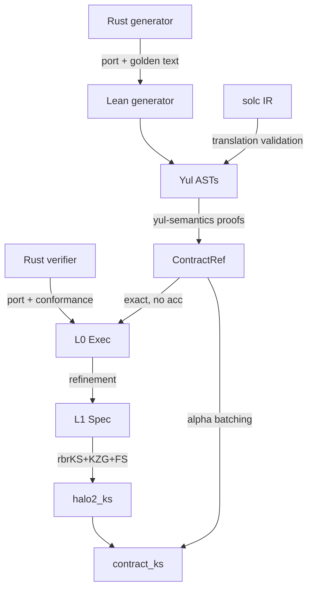

# Midfall formal: faithful Lean 4 port of the Halo2 verifier and verified Solidity/Yul lowering

> Copy of the normative plan, kept in the repository so that a work package, a
> review checklist or a sub-agent brief can cite it by section number. The
> meaning of §9 is normative and is mirrored by the frozen
> `Midfall/Statements.lean` (D6), whose SHA-256 CI checks. What the plan called
> "ecosystem identifiers" (ArkLib, VCVio, CompPoly, yul-semantics) were
> placeholders until the Phase 1 inventory confirmed them: see
> `docs/ecosystem.md` for what actually exists, `docs/design.md` for the
> sign-off decisions (D-P1 ... D-P7) taken against it, and `docs/REVIEW.md` for
> the port findings that cross module boundaries (R-1 ... R-10).
>
> Amended 2026-10-23: solc IR translation validation moved from stretch goal to
> a required step (§7, M8); §9.5 now states the headline `lowering_equivalence`
> as one observational-equivalence theorem over the *compiled-contract model*
> rather than as separate L1/L2/L3 theorems; §9.6 becomes `deployed_equivalence`;
> the trusted base splits solc into a checked Solidity→Yul-IR hop and a trusted
> Yul-optimizer/bytecode hop (§1); and the accumulator-α question the plan added
> under Exec/Accumulator is answered in the negative (R-10), which makes the
> `accumulator = none` hypothesis on the exact equivalences necessary.

The statements below are pseudo-Lean. Their **meaning is normative**. Ecosystem identifiers (ArkLib, VCVio, CompPoly, yul-semantics) are placeholders until the Phase 1 inventory confirms them. Implementers may fix names and syntax only. Any change in meaning needs sign-off.

## 0. Proof architecture and deliverables



**Headline results**
- **`lowering_equivalence`** (§9.5) is generic over every supported VK and config. It concerns the compiled-contract model, meaning solc's IR of the generated `.sol` file. That model returns ABI `true` **iff** the Lean verifier accepts the decoded calldata; otherwise it reverts or halts without changing state.
- **`end_to_end_noAcc`**: the Lean `verifyNative` accepts a compressed Rust proof π **iff** the contract returns `true` on `encodeCalldata (repack π) inst`.
- **`deployed_equivalence`**: the Lean generator reproduces the deployed Moonlight artifacts **as Yul ASTs** (structural equality, formatting and comments ignored), so both theorems apply to the deployed code. The link from the deployed artifact to its bytecode is the revm differential (M4), not text equality.
- **`contract_knowledgeSound`**: knowledge soundness of the deployed contract in AGM + ROM.

**Deliverables**
- **D0**: frozen Rust baseline `formal-baseline-v1` (main plus the 4 branches).
- **D1**: `formal/` Lake project on Lean v4.35.0. It depends on ArkLib (which brings mathlib, VCVio and CompPoly) and on a pinned fork of powdr-labs/yul-semantics.
- **D2**: `Midfall.Halo2.Exec`, an executable, line-faithful port of `proofs/src` @ 2d52f24 plus the accumulator pieces.
- **D3**: `Midfall.Generator`, a line-faithful port of `halo2_solidity_verifier` at the baseline. It emits typed Yul ASTs that are structurally equal to the ASTs the Rust emits; printed text must be *compilable and semantically equivalent*, not byte-identical (D-P13).
- **D4**: a conformance harness (Rust exporter plus Lean runner) and differential validation of the Yul semantics against revm.
- **D5**: proofs covering refinement, security, lowering equivalence (VM path first, then Direct), solc IR translation validation and the per-deployment theorem.
- **D6**: `formal/Midfall/Statements.lean`, holding the §9 statements. This file is frozen and CI checks its hash.

## 1. Trusted base

| Item | Treatment |
|---|---|
| Lean kernel + propext/Classical.choice/Quot.sound | trusted; `#print axioms` gate in CI |
| mathlib/ArkLib/VCVio/CompPoly/yul-semantics | trusted libraries; any `sorry` they contain that we depend on is listed as an explicit assumption (Phase 1 inventory) |
| BLS12-381 Fp/Fp2/Fp12, G1/G2, pairing | reuse the ecosystem implementations; if bilinearity or non-degeneracy is unproven, it becomes a named hypothesis in `Assumptions/Pairing.lean` |
| EIP-2537 (0x0b G1ADD, 0x0c G1MSM, 0x0f PAIRING_CHECK), modexp 0x05 (EIP-198/7883) | assumption, stated as a yul-semantics `ExternalCalls` relation; validated on revm |
| Keccak-256 | concrete for execution; a random oracle in the security proofs; known-answer tests. The lowering proofs work for **any** hash `H` |
| q-DLOG in AGM (and/or ArkLib ARSDH and KZG function binding) | assumption |
| AGM | modelled as a restriction on adversaries: they must output representations |
| solc 0.8.30, Solidity → Yul IR | **checked**: `solc --ir` output is translation-validated against the verified blocks and shell model (§7) |
| solc Yul optimizer and Yul → EVM bytecode | trusted, validated by revm differential tests. Future work: a verified Yul→EVM compiler built on yul-semantics |
| Lean port is faithful to Rust | validated rather than proven, through review, conformance, coverage and mutation tests (Rust is the reference) |

Out of scope: exact gas, prover code (the honest prover exists only as a mathematical spec), keygen code (the VK is imported from Rust and `transcript_repr` is taken as given), trace and gas-checkpoint render modes, and transcripts other than Keccak.

## 2. Phase 0: integrate the branches and freeze the baseline (Option B)

Run gate G0 after each step.
1. `git switch -c formal/baseline origin/main` (2d52f24).
2. Merge `quotient-vm-bounds` (1b30071, which contains 6b3d209). This merge is conflict-free.
3. Merge `quotient-vm-listing` (f1ceae6). This merge is conflict-free.
4. Merge `quotient-hybrid` (d5a7e30). It has 4 conflicts with main, 3 with listing and 3 with bounds. Resolve them by keeping both sides' meaning:
   - Keep `QuotientLowering::{Vm, Direct}` with `Vm` as the default.
   - Keep QVM-01 operand validation and the runtime guards on the VM path.
   - Keep the listing manifest and disasm for VM. Direct either emits its own manifest entries or is flagged `uncertified` in diagnostics.
   - The transcript buffer sizing and const-table fix (6b3d209) must survive on both paths.
5. Do **not** merge misc-fixes (4f03428). It is stale and lacks id_point_fix and affa8a6. Re-apply its changes as curated commits, each with its tests, in this order:
   1. Typed errors and the `MemoryLayoutViolated` guard.
   2. Memory above the solc via-IR spill window (6333673, 60f842b).
   3. Lagrange scratch owned by the planner (6753679).
   4. Exact precompile gas and SRS tau binding (f1840bd).
   5. EIP-7883 modexp (8e65c96).
   6. PrecompileSmoke.
   7. Rejection of non-canonical scalars and off-curve points.
   8. `vk_digest` in the alpha preimage (86b262e).
   9. `vm/certify.rs` and `vm/reference.rs`.
   10. BUILD_ID and template digest.

   Skip a01b1ea (a duplicate of 6b3d209) and `_to_delete/`.
6. Regenerate the fixtures, gas snapshots and `deployments/sepolia/moonlight-wrap/*`, and review the diffs.
7. **G0**: `cargo test -p midnight-proofs`, `cargo test -p halo2_solidity_verifier --features evm` (plus the CI feature matrix), the revm PRAGUE fixtures (ivc, poseidon, rsa_signature) on both quotient lowerings, and Moonlight wrap end to end.
8. Freeze: tag `formal-baseline-v1` and write `formal/BASELINE.md`. It records the commits, solc/revm versions, cargo features and build profile (overflow-checks, debug-assertions) and fixture SHA-256s. After the freeze, any Rust change goes through a "baseline bump": re-run conformance and update the port diff.

## 3. Phase 1: Lean project and ecosystem inventory

```
formal/
  lean-toolchain            leanprover/lean4:v4.35.0 (match ArkLib)
  lakefile.toml             ArkLib @pinned; yulSemantics = fork of powdr-labs/yul-semantics @c9914c1, bumped to v4.35.0
  BASELINE.md  docs/{ecosystem.md, security.tex, lowering.md}
  Midfall/
    Assumptions/{Eip2537,Modexp,Pairing?,Hardness}.lean
    Common/{Bytes,Word,Field,Curve,Codec,Keccak,Json}.lean
    Halo2/Exec/{Features,Error,Circuit,Poly,Domain,Query,Pcs,Transcript,VerifyingKey,
                Permutation,Logup,Trash,Linearization,Kzg/{Msm,Utils,MultiOpen,Params},
                Verifier,Native,Accumulator,Msgs}.lean      -- faithful, executable, no proofs
    Halo2/Spec/{Relation,Keygen,Degrees,Piop,Refinement}.lean
    Security/{ROM,AGM,Games,PIOP,KZG,FiatShamir,Batching,Completeness,Main}.lean
    Generator/...            (§8)
    Yul/{Bridge,Externals,ShellModel,Print,ImportSolcIR,IRCheck}.lean
    Lowering/{Layout,Calldata,VkLoading,Transcript,Lagrange,Quotient/{QVM,VmYul,Direct},Pcs,FinalPairing,Main}.lean
    Instances/MoonlightWrap.lean       -- only place native_decide is allowed
    Statements.lean                    -- frozen
  conformance-rs/           Rust workspace member: JSON/bin exporter + revm runner
  Conformance/              Lean exe `midfall-conformance`
```

**Inventory** (`docs/ecosystem.md`). For each item, record the exact name, file, whether it is computable, and the `#print axioms` result:
- Fr, Fp, Fp2, Fp12, the curve E1 and its group law, the G1 r-torsion subgroup, G2, the pairing and its bilinearity and non-degeneracy, and any point codecs.
- ArkLib: `KZG.*`, function binding, `Groups.arsdhAssumption`, AGM, `ProtocolSpec`, `OracleReduction`, `Verifier.knowledgeSoundness`, `rbrKnowledgeSoundness`, `Verifier.fiatShamir`.
- VCVio: `OracleSpec`, `randomOracle`, `loggingOracle`, `simulateQ`, `QueryLog`, `Pr[...]`, `keccak256`.
- yul-semantics: AST, `EVM.evmWithExternal`, `ExternalCalls`, `RunContract`, `RunCommitted`, `Object`/`ObjectRun`, the interpreter and its adequacy proof, determinism.

**Gap policy**:
- A missing executable piece is implemented in `Common/`, together with a proof that it equals the ecosystem definition.
- A missing proof becomes a named hypothesis structure in `Assumptions/`. A bare `sorry` is never allowed.

**Exit criteria for Phase 1**:
- `Statements.lean` compiles with `sorry`.
- CI runs `lake build`, the axioms check, the `sorry` allowlist, the ban on `native_decide` outside `Instances/`, and the frozen-statements hash.

## 4. Phase 2: faithful port of the Rust verifier (L0)

**Port rules (normative)**
- **R1 Provenance.** Each Lean `def` carries a comment of the form `-- rust: <path>:<lines> @<commit>`. There is one Lean def per Rust fn, including private helpers, with statements in the same order and no "improvements".
- **R2 Names.** snake_case becomes lowerCamelCase. Type names are kept as they are.
- **R3 Control flow.** `?` becomes the left-arrow bind in `Except`. Early `return` is kept. Iterator chains are mirrored exactly: `zip` truncates to the shorter input, and `chain`, `rev`, `enumerate`, `skip`, `take`, `flat_map` and `fold` behave as in Rust.
- **R4 Panics.** `unwrap`, `expect`, `panic!`, `assert!`, `unreachable!`, out-of-bounds indexing, and overflow (if overflow-checks is on in the reference profile) all become `throw (.panic "<path>:<line>")`. `debug_assert!` follows the recorded build profile.
- **R5 Integers.** Use `Nat`/`Int`. Wrapping is emulated only where it can actually occur; otherwise prove a `noOverflow` lemma.
- **R6 Collections.**
  - `Vec` becomes `Array`.
  - `BTreeMap`/`BTreeSet` become sorted lists using the *same* `Ord`, porting the field order of `#[derive(Ord)]` exactly.
  - `HashMap` is allowed only where its iteration order cannot be observed, and that must be argued.
  - `IndexMap` becomes a list in insertion order.
- **R7 Fields and curve.** `invert` returns `Option`. `batch_invert` follows halo2 exactly (zeros are skipped). `from_repr` checks canonicity. Exponentiation uses explicit square-and-multiply. Identity handling for projective vs affine points is mirrored.
- **R8 Features.** Each `#[cfg(feature)]` becomes `if F.x then ... else ...`, and both branches are ported. `Features.solidity` is fixed from BASELINE.md.
- **R9 Generics.** Traits (`PolynomialCommitmentScheme`, `Transcript`, `Hashable`, `Guard`) become structures of functions, instantiated with KZG + Keccak. The hash is a parameter `H : Hash` everywhere, defaulting to keccak256.
- **R10.** Exec code is computable and never `partial` (use `termination_by`). Proofs live in `*/Lemmas.lean`.
- **R11 Review.** Each module PR includes a checklist mapping Rust line ranges to Lean defs, signed off by a second agent.

**Module map**

| Rust | Lean | Notes |
|---|---|---|
| plonk/error.rs | Exec/Error | all variants; `Transcript(io::Error)` -> `transcript (k : IoErrorKind)` |
| plonk/circuit.rs (verifier subset) | Exec/Circuit | Column/Any/Phase/Challenge/Selector/queries/Expression (Constant, Selector, Fixed, Advice, Instance, Challenge, Negated, Sum, Product, Scaled)/Gate/ConstraintSystem fields 1678-1727, `degree`, `blinding_factors`, `evaluate` (a virtual selector panics) |
| plonk/mod.rs | Exec/VerifyingKey | `{domain, fixed_commitments, permutation, cs, cs_degree, transcript_repr}`, `hash_into` |
| plonk/verifier.rs | Exec/Verifier | VerifierTrace, `parse_trace`, `verify_algebraic_constraints`, `prepare` |
| plonk/permutation/*, logup/*, trash/*, linearization/verifier.rs | Exec/{Permutation,Logup,Trash,Linearization} | verifier paths only |
| plonk/evaluation.rs | only what the verifier can reach | check reachability first |
| poly/{mod,domain,query,commitment}.rs | Exec/{Poly,Domain,Query,Pcs} | Rotation, `rotate_omega`, `l_i_range`, quotient degree, VerifierQuery, CommitmentReference |
| poly/kzg/{mod,msm,utils,params}.rs | Exec/Kzg/* | `multi_prepare`, `construct_intermediate_sets`, MSMKZG (`msm_specific` drops zero coefficients), DualMSM.check (msm.rs:284), ParamsVerifierKZG |
| transcript/{mod,implementors}.rs | Exec/Transcript | `CircuitTranscript<Keccak256>` only: `init_from_bytes`, absorb, squeeze (digest, then reseed), challenge = BE digest mod r (implementors.rs:29-39), G1 `to_input` 128B EIP-2537, wire 48B; Fq `to_input` BE, wire LE |
| utils/{arithmetic,helpers}.rs | Exec/Arith | `eval_polynomial`, inner product, powers, `batch_invert` |
| curves/src/bls12_381/g1.rs, fq | Common/Curve, Codec | `from_compressed` = on-curve AND torsion-free (369-371), `to_compressed`, Fq repr LE |
| solidity-verifier/src/test.rs:340-367 | Exec/Native | the canonical composition |
| aggregation/src/ivc/verifier.rs:111, circuits/src/verifier/accumulator.rs:90, foreign-point public-input encoding | Exec/Accumulator | KzgAcc, `check`, `from_dual_msm`, `encodeAccInstances`. **Determine whether `verify_final` batches the accumulator with the same α as FinalPairing.yul** (this decides whether the acc-mode equivalence to Rust is exact). ANSWERED: it does not - see docs/REVIEW.md R-10 |

## 5. Phase 3: conformance harness

- **`conformance-rs` exporter** (uses the `rust-verifier-trace` feature):
  - `vk.json`: full cs, k, omega, commitments, `cs_degree`, `transcript_repr`.
  - `params.json`: g1, g2, s_g2, n_g2.
  - `proof.bin` and `instances.json`.
  - `trace.json`: every absorb/squeeze, the challenges, all evaluations, MSM terms, the DualMSM left/right points, and the result.
  - Generator outputs: `.sol` for every `RenderOptions` used, `plan.json`, the QVM listing and certificate, and `calldata.bin`.
  - solc outputs: `--ir-ast-json` for the verifier and the evaluator.
- **Lean runner `midfall-conformance`**:
  - Parses the JSON and runs `verifyNative` and `render`.
  - Compares accept/reject, the error class, every trace value, and the generated text **modulo formatting and comments** (D-P13).
  - If the pairing is not executable in Lean, it compares the pairing *inputs* and the Rust check result.
- **Corpus**:
  - The ivc, poseidon and rsa_signature fixtures and Moonlight wrap (k=20).
  - Synthetic small circuits covering each feature: multi-chunk logup, trash, permutation across many columns, +/- rotations, committed instances, and accumulator encodings.
  - A mutation corpus of at least 10k bit flips per fixture.
- **Exit criteria**:
  - 100% agreement.
  - `cargo llvm-cov` reaches every live branch of the verifier and generator under the corpus; unreachable branches are justified.
  - Spec keygen recomputes the VK commitments for small-k fixtures from exported columns and SRS.

## 6. Phase 4: spec layer and refinement

`Spec/Relation` and `Spec/Keygen` (Section 9.3). `Spec/Piop` contains the mathematical verifier:
- challenges taken from the hash chain;
- the vanishing/linearized identity at x;
- the permutation, logUp and trash identities;
- the multi-open checks.

**Lemma inventory**:
- Lagrange and `l_i_range` closed forms;
- Z_H and `rotate_omega`;
- `Expression.evaluate` as a ring homomorphism;
- permutation grand-product telescoping;
- the logUp rational identity (char > n);
- trash Horner;
- linearization;
- correctness of `construct_intermediate_sets`;
- DualMSM scaling and the pairing-reorder lemma: Rust `e(left,sG2)·e(right,−G2)=1` ⇔ contract `e(right,G2)·e(left,−sG2)=1` (the layout is AssemblyHelpers.yul:269-287, `ec_pairing`, and the RHS/LHS swap happens at the call site FinalPairing.yul:88 - see docs/REVIEW.md R-11).

## 7. Phase 5: Yul/EVM via yul-semantics, plus solc IR translation validation

- Fork and pin c9914c1, bumping its toolchain to v4.35.0. It depends only on Batteries, so this is mechanical. Keep our additions in `Midfall/Yul/` (upstreamable).
- Dialect: `EVM.evmWithExternal (calls L W) noCreates`. The `keccak256` oracle is `H`, and `gas()` stays nondeterministic. extcodehash and extcodecopy go through the environment maps. STATICCALL frames are static.
- `Externals.lean`: EIP-2537 and modexp relations (byte-exact layouts, validity checks, outputs, gas cost functions), plus the quotient-evaluator call, which runs the evaluator's Yul object in a static frame.
- `ShellModel.lean`: a Yul model of solc's dispatcher for `verifyProof(bytes,uint256[])`, covering selector 0x1e8e1e13, the callvalue check, ABI bounds checks, and binding the locals `vk` and `quotientEvaluator` from immutables.
- **Required step: solc IR translation validation.**
  - `ImportSolcIR.lean` imports `solc --ir-ast-json` (the unoptimized IR of the whole contract, with our inline assembly embedded) into the yul-semantics AST.
  - `IRCheck.lean` is a verified checker: `irCheck ir L = true → ObsEquiv ir (ShellModel.wrap L)`.
  - What it checks: the embedded assembly blocks are α-equivalent to `L.headGuard` and `L.main`; the dispatcher and ABI-decoding code has the recognised shape, with its semantics proven; immutables come from `loadimmutable`, which equals constructor-set values; the memoryguard and spill region are disjoint from `L.plan.memory`.
  - The same applies to `Halo2QuotientEvaluator` (fallback).
- revm differential:
  - Run solc bytecode on revm and the yul-semantics interpreter (concrete keccak) on the same inputs.
  - Precompile results are replayed from revm, and the Lean side checks it issues *identical* call inputs.
  - Compare outcome, return data and the sequence of external calls, over fixtures, mutations and random calldata. This covers the trusted optimizer and bytecode step.

## 8. Phase 6: generator port

The same rules R1-R11 apply. The baseline layout is shown; `vm/certify.rs`, `vm/reference.rs`, `disasm.rs` and `direct/` arrive with Phase 0.

| Rust (proofs/solidity-verifier/src) | Lean (Midfall/Generator) |
|---|---|
| api.rs | Api (GeneratorConfig, AccumulatorEncoding, RenderOptions, RenderedArtifacts, GeneratorError, Quotient* types) |
| builder/{mod,api,render,repack}.rs | Builder (`tryNew` mirrors validation in api.rs:21+, `render`, `renderQuotientEvaluator`) |
| lowering/{mod,config,plan,diagnostics,artifacts}.rs | Plan, Config (LoweringPlan, `quotient_operand_model`) |
| lowering/protocol/mod.rs | Protocol (transcript schedule) |
| lowering/layout/{mod,memory,vk_payload}.rs | Layout/* |
| lowering/{encoding,abi/*,calldata,vk}.rs | Encoding, Abi, Calldata (`repack_proof`), Vk |
| lowering/kzg/mod.rs | Kzg (PCS lowering) |
| lowering/quotient.rs, quotient_numerator/{mod,vm/*,yul_emit}.rs, direct/ | Quotient, QuotientNumerator/{Vm,VmCertify,VmReference,Disasm,YulEmit,Direct} |
| lowering/render/{mod,models,yul}.rs + templates/** | Render/*, Templates/* (one Lean fn per template/partial producing a `Yul.Block`; Jinja filters such as `hex()` ported exactly) |
| evm.rs (`encode_calldata`, `FN_SIG_VERIFY_PROOF`) | Evm |

Required equation: `render g o = (lower g o).map print` holds by construction. Golden test: the Lean AST is structurally equal (`YulSemantics.Ast.stmtsBeq`) to the AST parsed from the Rust output for every corpus VK x option set and for the deployed Moonlight artifacts. Formatting and comments are NOT part of the equality (D-P13); a canonical renderer is still required so the AST can be handed to solc.

## 9. Normative statements (pseudo-Lean)

### 9.1 Common
```lean
namespace Midfall
abbrev Fr := BLS12_381.ScalarField   abbrev Fp := BLS12_381.BaseField
abbrev E1 := BLS12_381.G1Curve.Point            -- all curve points (G1ADD has no subgroup check)
abbrev G1 := BLS12_381.G1                       -- r-torsion, Module Fr G1
abbrev G2 := BLS12_381.G2   abbrev GT := BLS12_381.GT
def e : G1 → G2 → GT := BLS12_381.pairing
abbrev H256 := BitVec 256
abbrev Hash := ByteArray → H256                 -- keccak256, or a random oracle
def frOfDigest (d : H256) : Fr := (d.toNat : Fr)             -- implementors.rs:29-39
def G1.ofCompressed? : ByteArray → Option G1                 -- on-curve ∧ torsion-free
def E1.ofEip? : ByteArray → Option E1                        -- 16 zero ‖ x ‖ 16 zero ‖ y, < p, on-curve; 0^128 = ∞
def G1.ofEip? (b) : Option G1 := (E1.ofEip? b).bind toSubgroup?
def E1.toEip : E1 → ByteArray
```

### 9.2 L0 interface (faithful)
```lean
namespace Midfall.Halo2
structure Features where committedInstances truncatedChallenges outerFewerPointSets outerSingleHCommitment : Bool
def Features.solidity : Features := …                        -- from BASELINE.md
inductive Fault | error (e : Error) | panic (site : String)
abbrev TranscriptM := StateT Transcript (Except Fault)
structure VerifierEnv where g1 : G1Codec G1; field : FieldConsts Fr; delta : Fr; fewerPointSetsRuntime : Bool
def prepare (E : VerifierEnv) (F) (vk : VerifyingKey) (committed : List (List G1)) (inst : List (List (List Fr))) : TranscriptM DualMSM
def DualMSM.check (g : DualMSM) (p : ParamsVerifierKZG) : Bool   -- e(left,sG2)·e(right,−G2)=1
def verifyNative (E : VerifierEnv) (F) (p) (vk) (inst : Array Fr) (proof : ByteArray) : Except Fault Unit := do
  let (g, t) ← (prepare E F vk [[0]] [[inst.toList]]).run (Transcript.initFromBytes proof)
  t.assertEmpty
  unless g.check p do throw (.error .opening)
inductive Msg | g1 (P : G1) | fr (s : Fr)
def decodeRust (E : VerifierEnv) (F) (vk) (inst : Array Fr) : ByteArray → Option (List Msg)
def prepareMsgs (E : VerifierEnv) (H : Hash) (F) (vk) (inst) (ms : List Msg) : Except Fault DualMSM
def verifyMsgs (E : VerifierEnv) (H : Hash := keccak256) (F) (p) (vk) (inst) (ms) : Except Fault Unit
theorem verifyNative_iff_msgs : verifyNative F p vk inst π = .ok () ↔
  ∃ ms, decodeRust E F vk inst π = some ms ∧ verifyMsgs E keccak256 F p vk inst ms = .ok ()
theorem verifyMsgs_iff_spec (hwf : vk.WellFormed F) :
  (verifyMsgs E H F p vk inst ms).isOk ↔ Spec.accepts H F p vk inst ms
```

The interface re-pin bundles the verifier runtime inputs. It does not yet
complete `decodeRust`'s read-schedule implementation or parameterise the
transcript over `H`; see D-P9 in `docs/design.md`.

### 9.3 Relation
```lean
namespace Midfall.Halo2.Spec
structure CircuitIndex where
  cs : ConstraintSystem Fr;  k : ℕ
  fixed : Fin cs.numFixedColumns → Fin (2^k) → Fr
  perm  : PermutationAssembly cs k;  repr : Fr                 -- transcript_repr as given by Rust
def keygenVK (s : SRS N) (idx) : VerifyingKey                  -- commitments [p(τ)]₁ of interpolated columns / σ
structure Witness (idx) where advice : Fin idx.cs.numAdviceColumns → Fin idx.n → Fr
def Satisfies (idx) (inst : Array Fr) (w : Witness idx) : Prop :=
  CommittedInstanceZero idx                                     -- identity commitment (assessment F3)
  ∧ (∀ g ∈ idx.cs.gates, ∀ p ∈ g.polys, ∀ i ∈ idx.usable, evalRow idx inst w p i = 0)
  ∧ (∀ c ∈ idx.perm.cycles, ∀ a ∈ c, ∀ b ∈ c, cell idx inst w a = cell idx inst w b)
  ∧ (∀ L ∈ idx.cs.lookups, ∀ inp ∈ L.inputs, ∀ i ∈ idx.usable, ∃ j ∈ idx.usable,
        rowTuple idx inst w inp i = rowTuple idx inst w L.table j)
  ∧ (∀ T ∈ idx.cs.trashcans, ∀ i ∈ idx.usable, evalRow idx inst w T.selector i = 1 →
        ∀ c ∈ T.constraints, evalRow idx inst w c i = 0)
def Rel (idx) : Set (Array Fr × Witness idx) := {p | Satisfies idx p.1 p.2}
```

### 9.4 Security
```lean
namespace Midfall.Security
abbrev roSpec := (ByteArray →ₒ H256)
structure SRS (N) where g1Pow : Fin N → G1; g2 sg2 : G2
def SRS.gen (N) (τ : Fr) : SRS N := ⟨fun i => (τ ^ i.val) • G1.gen, G2.gen, τ • G2.gen⟩
structure Rep (N) where pt : G1; coeff : Fin N → Fr                   -- AGM representation
def Rep.Valid (s : SRS N) (r : Rep N) : Prop := r.pt = ∑ i, r.coeff i • s.g1Pow i
structure AlgProof (N) where
  inst : Array Fr;  msgs : List (Fr ⊕ Rep N);  accReps : Option (Rep N × Rep N)
abbrev Adversary (N) := SRS N → OracleComp roSpec (AlgProof N)
abbrev Extractor (idx N) := SRS N → AlgProof N → QueryLog roSpec → Witness idx   -- straight-line
def verifyRO (F) (p) (vk) (inst) (ms) : OracleComp roSpec Bool          -- verifyMsgs with H := query

def ksGame (F idx N) (A : Adversary N) (E : Extractor idx N) : ProbComp Bool := do
  let τ ← $ᵗ Fr;  let s := SRS.gen N τ;  let vk := keygenVK s idx
  let ((π, ok), log) ← (simulateQ randomOracle.withLogging (do
      let π ← A s;  let ok ← verifyRO F s.params vk π.inst π.msgs';  pure (π, ok))).run ∅
  pure (ok && π.repsValid s && !((π.inst, E s π log) ∈ Rel idx))

def qdlogGame (N) (B : SRS N → ProbComp Fr) : ProbComp Bool := do
  let τ ← $ᵗ Fr;  pure ((← B (SRS.gen N τ)) == τ)

def chalMass (F : Features) (s : ℕ) : ℝ≥0 :=                          -- ⌈2^256/r⌉ = 3
  if F.truncatedChallenges then s / 2^128 else 3 * s / 2^256
inductive Chal | theta | beta | gamma | trash | y | x | x1 | x2 | x3 | x4
def roundErr (F idx) : Chal → ℝ≥0                      -- degrees defined in Spec/Degrees (paper proof first)
  | .theta => chalMass F (degTheta idx) | .beta => chalMass F (degBeta idx)
  | .gamma => chalMass F (degGamma idx) | .trash => chalMass F (degTrash idx)
  | .y => chalMass F (numConstraints idx) | .x => chalMass F (idx.cs.degree * idx.n + idx.n)
  | .x1 => chalMass F (maxPolysPerSet idx) | .x2 => chalMass F (numPointSets idx)
  | .x3 => chalMass F (maxSetSize idx * idx.n) | .x4 => chalMass F (numPointSets idx + 1)
def ksErr (F idx qH) : ℝ≥0 := (qH + 1) * ∑ c, roundErr F idx c + (qH + verifierQueries idx)^2 / 2^256

/-- S1 MAIN: knowledge soundness of the native verifier, AGM + ROM, reducing to q-DLOG. -/
theorem halo2_knowledgeSound (idx) (hwf : idx.WellFormed .solidity) (h1 : idx.cs.numChallenges = 0)
    (N) (hN : idx.srsBound ≤ N) (A : Adversary N) (qH) (hq : A.queryBound qH) :
    Pr[= true | ksGame .solidity idx N A (halo2Extractor idx)]
      ≤ ksErr .solidity idx qH + Pr[= true | qdlogGame N (qdlogReduction idx A)]
-- halo2Extractor: advice column j := evaluations on the domain of the polynomial given by the AGM
-- coefficients of the j-th advice commitment.

/-- S2: the PIOP in ArkLib (polynomial oracles; challenges are H256, mapped by frOfDigest). -/
theorem halo2PIOP_rbrKS (idx) (hwf) (h1) :
  (halo2PIOP .solidity idx).verifier.rbrKnowledgeSoundness (init := pure ()) (impl := idImpl)
    (Rel idx) acceptRejectOracleRel (fun i => roundErr .solidity idx (chalOf i))

/-- S3: KZG multi-open evaluation binding in AGM (multi_prepare + DualMSM.check). -/
theorem kzgMultiOpen_binding (N) (A) (hq) :
  Pr[multiOpenAccepts ∧ ∃ q ∈ queries, q.eval ≠ (polyOf q.rep).eval q.point]
    ≤ (qH + 1) * (roundErr F idx .x1 + roundErr F idx .x2 + roundErr F idx .x3 + roundErr F idx .x4)
      + Pr[= true | qdlogGame N (kzgReduction A)]
-- alternative instantiation: ArkLib KZG.CommitmentScheme.function_binding under ARSDH

/-- S4: the Keccak hash chain in the ROM simulates ArkLib's FS oracle on the injective encoding
    (repr, instances, prefix), up to chain collisions. -/
theorem keccakChain_simulates_fs : ∀ A E, Pr[E | chainGame A] ≤ Pr[E | fsGame A] + (qH + V)^2 / 2^256
theorem verifyRO_eq_compiled : verifyRO F p vk inst ms = (fsKeccak (compileKZG (halo2PIOP F idx))).verify …

/-- S5: accumulator α batching (exact preimage = baseline FinalPairing.yul, incl. vk_digest). -/
def alphaOf (H) (vkd : Fr) (g : DualMSM) (a : KzgAcc) : Fr :=
  let α := frOfDigest (H (tag ++ vkd.toBE ++ g.right.toEip ++ g.left.toEip ++ a.right.toEip ++ a.left.toEip))
  if α = 0 then 1 else α
def batchedCheck (p α g a) : Bool := e (g.right + α • a.right) p.g2 * e (g.left + α • a.left) (-p.sg2) = 1
theorem batched_complete (h : g.check p ∧ a.check p) : ∀ α, batchedCheck p α g a
theorem batched_atMostOneRoot (h : ¬(g.check p ∧ a.check p)) : {α | batchedCheck p α g a}.Subsingleton
theorem alpha_batching_sound (A : OracleComp roSpec (DualMSM × KzgAcc)) (hq : A.queryBound qH) :
  Pr[do let (g,a) ← A; let α ← alphaRO vkd g a; pure (batchedCheck p α g a && !(g.check p && a.check p))]
    ≤ 6 * (qH + 1) / 2^256

/-- S6: completeness against a spec-level honest prover. -/
theorem halo2_complete (idx hwf h1 inst w) (hw : (inst, w) ∈ Rel idx) (N hN) :
  Pr[= true | do let τ ← $ᵗ Fr; let s := SRS.gen N τ; let ms ← honestProve .solidity s idx inst w
                 verifyRO .solidity s.params (keygenVK s idx) inst ms] ≥ 1 - complErr .solidity idx

/-- S7 MAIN: deployed contract. The adversary outputs calldata plus AGM representations; KECCAK256 is
    the RO inside yul-semantics. This follows from S1, S5, L1 and lazy sampling (Security/ROM). -/
theorem contract_knowledgeSound (g o L) (hL : g.lower o = .ok L) (hsup : Supported g o) (A qH hq) :
  Pr[= true | contractKsGame g L N A (contractExtractor g)]
    ≤ ksErr .solidity g.idx qH + (if g.cfg.accumulator.isSome then 6 * (qH + 1) / 2^256 else 0)
      + Pr[= true | qdlogGame N (B A)]
-- success event: verifier returns abiTrue ∧ reps valid ∧ ¬(decodes to (ms, inst) ∧ (inst, E…) ∈ Rel ∧ AccOK)
```

### 9.5 Lowering correctness: semantic equivalence of the Lean verifier and the generated Solidity/Yul
"Equivalence" is observational at the call boundary: the success/revert outcome, return
data and world effects. Lean error classes all map to "revert".

```lean
namespace Midfall.Lowering
structure Lowered where
  plan : LoweringPlan; headGuard main : Yul.Block; shell : SolShell
  vkRuntime : ByteArray; evaluator : Option Yul.Object; consts : TemplateConstants
def SolidityGenerator.lower (g) (o : RenderOptions) : Except GeneratorError Lowered
theorem render_eq_print : g.render o = (g.lower o).map Lowered.print

structure Supported (g o) : Prop where          -- mirrors try_new plus what the proofs need; decidable
  advice : g.vk.cs.numAdviceColumns ≠ 0
  instShape : g.vk.cs.numInstanceColumns = 2 ∧ g.cfg.numCommittedInstances = 1
  noRotInst : ∀ q ∈ g.vk.cs.instanceQueries, q.2 = .cur
  acc : ∀ enc, g.cfg.accumulator = some enc → enc.validFor g.cfg.numInstances
  singlePhase : g.vk.cs.numChallenges = 0
  hLimbs : g.plan.numQuotientLimbs = g.vk.cs.degree - 1          -- assessment F7
  vkPoints : ∀ C ∈ g.vk.allCommitments, C.isValidG1
  layout : g.plan.memory.WellFormed     -- disjoint, aligned, above solc spill window
  qvm : validateQuotientProgramOperands g.plan = .ok ()           -- QVM-01
  production : o.diagnostics.trace = false ∧ o.diagnostics.gasCheckpoints = false

structure Deployment (L W) : Prop where
  vkCode : W.code L.vkAddr = L.vkRuntime;  vkHash : W.extcodehash L.vkAddr = L.plan.vkCodehash
  qObj : L.evaluator.isSome → W.object L.quotientAddr = L.evaluator.get!
  qHash : L.evaluator.isSome → W.extcodehash L.quotientAddr = L.plan.quotientCodehash
def calls (L W) : EVM.ExternalCalls := Eip2537.rel ∪ Modexp.rel ∪ Evaluator.rel L W

-- the assembly alone (head guard; locals := immutables; main), from an arbitrary initial memory
def RunVerifier (H L W cd mem₀) (obs) : Prop :=
  EVM.RunCommitted (EVM.evmWithExternal (calls L W) noCreates) (keccak := H)
    (L.headGuard ++ bindLocals L ++ L.main) (initState W cd mem₀) obs
-- the compiled-contract model: solc's IR object of the generated .sol, imported and checked
def RunContractIR (H L W) (ir : Yul.Object) (cd) (c : EVM.ExternalCalls) (obs) : Prop :=
  EVM.RunCommitted (EVM.evmWithExternal c noCreates) (keccak := H) ir.runtime (callState W cd) obs

def ContractRef.accepts (H) (g) (ms) (inst) : Bool :=
  match prepareMsgs H .solidity g.vk inst ms with
  | .error _ => false
  | .ok d => match g.cfg.accumulator with
    | none => d.check g.params
    | some enc => match decodeAcc enc inst with
      | none => false | some a => batchedCheck g.params (alphaOf H g.vk.digest d a) d a
def LeanAccepts (H g L cd) : Prop :=
  ∃ ms inst, decodeCalldata L.plan cd = some (ms, inst) ∧ ContractRef.accepts H g ms inst

/-- HEADLINE: semantic equivalence. Generic over all supported VKs and configs, all
    calldata, any H. -/
theorem lowering_equivalence (g o L) (hL : g.lower o = .ok L) (hsup : Supported g o)
    (W) (hdep : Deployment L W) (hpc : Eip2537.Holds ∧ Modexp.Holds)
    (ir : Yul.Object) (hir : irCheck ir L = true) (H : Hash) (cd : ByteArray) :
    -- soundness: any run that returns, returns true, and Lean accepts
    (∀ obs, RunContractIR H L W ir cd (calls L W) obs → obs.isReturn →
        obs.data = abiTrue ∧ LeanAccepts H g L cd)
    -- completeness: Lean accepts ⇒ runs exist, and every run with honest precompiles
    -- and enough gas returns true
  ∧ (LeanAccepts H g L cd →
        (∃ obs, RunContractIR H L W ir cd (honestCalls L W) obs) ∧
        ∀ obs, RunContractIR H L W ir cd (honestCalls L W) obs → obs = .return abiTrue)
    -- only two outcomes, read-only
  ∧ (∀ obs, RunContractIR H L W ir cd (calls L W) obs →
        obs = .return abiTrue ∨ (obs.isRevertOrHalt ∧ obs.worldUnchanged))

/-- Exact equivalence to the Rust-faithful Lean verifier (no accumulator). -/
theorem lowering_equivalence_noAcc (h : g.cfg.accumulator = none) :
  LeanAccepts keccak256 g L cd ↔ ∃ ms inst, decodeCalldata L.plan cd = some (ms, inst) ∧
      verifyMsgs keccak256 .solidity g.params g.vk inst ms = .ok ()
theorem end_to_end_noAcc (h : g.cfg.accumulator = none) (hL hsup hdep hpc hir) :
  verifyNative .solidity g.params g.vk inst π = .ok () ↔
  ∃ cd, (repackProof L.plan π >>= (encodeCalldata L.plan · inst)) = .ok cd ∧
        ∀ obs, RunContractIR keccak256 L W ir cd (honestCalls L W) obs → obs = .return abiTrue
/-- Accumulator mode: exact w.r.t. ContractRef; against separate checks, exact one way,
    S5 the other. -/
theorem contractRef_acc_complete (h : g.cfg.accumulator = some enc) :
  verifyMsgs … = .ok () → (∃ a, decodeAcc enc inst = some a ∧ a.check g.params) → ContractRef.accepts H g ms inst

-- Building blocks the headline is proven from:
theorem ir_refines (hir : irCheck ir L = true) : ObsEquiv (RunContractIR H L W ir) (RunShell H L W)   -- §7
theorem verifier_sound (…) (hrun : RunVerifier H L W cd mem₀ obs) (hret : obs.isReturn) :   -- ANY mem₀
  obs.data = abiTrue ∧ LeanAccepts H g L cd
theorem verifier_complete (…) (hacc : LeanAccepts H g L cd) :
  ∀ obs, RunShell H L W cd (honestCalls L W) obs → obs = .return abiTrue
theorem points_subgroup_checked : every proof G1 point reaches G1MSM/PAIRING or an explicit check
theorem repack_spec : repackProof L.plan π = .ok π' ↔ ∃ ms, decodeRust .solidity g.vk π = some ms ∧ π' = encodeContractProof L.plan ms
theorem calldata_roundtrip : encodeCalldata L.plan (encodeContractProof L.plan ms) inst = .ok cd → decodeCalldata L.plan cd = some (ms, inst)
theorem calldata_canonical : decodeCalldata L.plan cd = some (ms, inst) → cd = calldataOf L.plan ms inst
  -- if the contract accepts trailing bytes or instance words ≥ r, weaken to `≈` and document the malleability
theorem decodeAcc_encode : decodeAcc enc (encodeAccInstances enc a) = some a      -- 7×56 limbs, coord−1, sentinel, identity flag
theorem decodeAcc_injective : decodeAcc enc i₁ = some a → decodeAcc enc i₂ = some a → accWords enc i₁ = accWords enc i₂
-- Quotient evaluator: VM first, then Direct
def QVM.run (prog : QVM.Program) (f : QVM.Frame) : Except QVM.Fault QVM.Output   -- port of vm/reference.rs
theorem qvm_compile_correct (hsup) : QVM.run L.plan.qprog (frameOf L.plan tr ev) = .ok (outputOf (quotientParts g.vk tr ev))
theorem qvm_validated_noOOB : validateQuotientProgramOperands L.plan = .ok () → f.WellFormed L.plan → QVM.run L.plan.qprog f ≠ .error .oob
theorem qvm_yul_refines : RunContract (evaluatorObject L) (calldata = f.bytes) (fun o => o = .return (QVM.run L.plan.qprog f).encode ∨ o.isRevert)
theorem direct_correct (hD : o.quotient = .direct) : same post as qvm_yul_refines for the Direct block
-- Per-partial contracts: Inv k relates memory to the L0 state after phase k (layout/memory.rs)
theorem vkLoading_spec        : RunContract (blk .vkLoading L) (Inv .start) (fun s => s.reverted ∨ Inv .vk s)
theorem transcriptParser_spec : … ∨ Inv .transcript s   -- challenges = L0 hash chain; canonical-scalar and padding rejection
theorem lagrange_spec         : … ∨ Inv .lagrange s
theorem quotientLin_spec      : … ∨ Inv .quotient s       -- linearization_expected_eval and buckets
theorem pcs_spec              : … ∨ Inv .pcs s            -- PAIRING_LHS/RHS = DualMSM left/right
theorem finalPairing_spec     : … ∨ Inv .pairing s        -- batchedCheck if acc, else d.check
theorem traceReturn_spec      : Inv .pairing → return(RETURN_MPTR, 0x20) with abiTrue
```

### 9.6 Per-deployment
```lean
theorem deployed_equivalence :                      -- Instances/MoonlightWrap.lean
  moonlightGen.lower prodOpts = .ok L   -- L's ASTs are stmtsBeq-equal to the assembly in deployments/sepolia/moonlight-wrap
  ∧ Supported moonlightGen prodOpts ∧ irCheck moonlightSolcIR moonlightLowered = true
-- with lowering_equivalence this gives the equivalence for the deployed contract itself
```

## 10. Proof work: order and method

1. Write the paper proof first in `docs/security.tex`: PLONK, plookup/logUp, the Halo2 book, the foreign-field paper (for accumulator limbs), and ArkLib KZG function binding.
2. Deterministic algebra lemmas (Phase 4) → codec lemmas (repack, calldata, accumulator) → per-partial contracts → `verifier_sound` / `verifier_complete` on the VM path → `ir_refines` → `lowering_equivalence` (VM) → S5 → S2 (one sub-argument at a time: gates/vanishing, permutation, logUp, trash) → S3 → S4 → S1 → S7 → Direct → `deployed_equivalence`.
3. Proof style for the lowering:
   - `RunContract` composition, one contract per partial.
   - Memory lemmas over `BitVec 256` words, with layout disjointness from `Supported.layout`.
   - Inductions over the generator's unrolled lists.
   - The QVM proof splits into compiler correctness over the Expression AST plus an interpreter refinement proved once.
   - All lowering proofs are hash-agnostic (∀ H), so they transfer to the ROM.

## 11. Milestones and acceptance

| # | Milestone | Acceptance |
|---|---|---|
| M0 | Baseline frozen | G0 green; tag + BASELINE.md |
| M1 | Skeleton + inventory | Statements.lean compiles with `sorry`; ecosystem.md |
| M2 | L0 port | conformance 100%, coverage report |
| M3 | Generator port | golden **AST** equality (formatting-insensitive, D-P13) on corpus + Moonlight |
| M4 | yul-semantics integration | revm differential green |
| M5 | Codecs and early phases | repack, calldata, accumulator, vkLoading, transcript, lagrange |
| M6 | QVM | qvm_* + evaluator frame theorem |
| M7 | VM-path lowering | pcs, finalPairing, `verifier_sound` / `verifier_complete`, `end_to_end_noAcc` |
| M8 | solc IR translation validation (required) | `irCheck` verified; `ir_refines`; `lowering_equivalence` with no `sorry` |
| M9 | Security | S1–S7 with no `sorry`; axioms limited to the trusted base |
| M10 | Direct | `direct_correct` + `lowering_equivalence` for Direct |
| M11 | Deployment | `deployed_equivalence` |

Parallel tracks after M1: A (M2 → M9), B (M3), C (M4). M5–M8 need A, B and C.

## 12. Rules for implementing agents

- Never edit `Statements.lean` semantics.
- One work package per PR: one module, or one theorem with its lemmas.
- Every `sorry` is tracked in `formal/SORRY.md` with an owner.
- Port PRs carry the R11 checklist.
- Proof PRs must leave `#print axioms` on the target within the trusted base.
- **Review independence (user-directed amendment, round 7).** A fresh agent session must perform adversarial review and independent verification after every completed task within a milestone. The reviewer must not be the author, must not inherit the author's reasoning, and must be briefed to *find* a divergence rather than confirm correctness. This closes the gap R-31 recorded: R11's "signed off by a second agent" was satisfiable by the author, so every author-written module went unchecked and both surviving bugs (R-20, R-30) were in that half.
  - **Deferred, round 9 (user-directed):** per-task review is suspended until the generator port (M3) is complete, to buy throughput. The rule is NOT withdrawn - it is queued. R-31's evidence says the deferred reviews will find real defects, so they are to be run as a batch against the whole port, not skipped. Every package that lands during the deferral carries its author's own perturbation evidence, because after this amendment that is the only check between an agent's claim and a commit.
- **No idle builds (user-directed amendment, round 9).** A build is never dead time. `lake build` here takes minutes and a package triggers several, so every agent must run builds in the background and keep working while they run: draft the next module, write the gate perturbations it will have to prove, read the Rust for the item it has not ported yet, or assemble the R11 checklist. A build only blocks the step whose answer it gates - whether one specific def elaborates. Everything not depending on that answer proceeds in parallel. Corollary: batch independent edits before a build instead of editing one def and waiting. The same rule binds the orchestrator, and round 9 is the evidence: the solc measurements behind R-42, R-44 and D-P15 were all done while a port agent was building.
- If a Rust behaviour makes a statement false (for example a subgroup-check gap, non-canonical acceptance, an F-finding, or the accumulator composition), stop and report a counterexample. Never weaken the statement silently.

## 13. Risks and open items

- **Toolchain:** yul-semantics needs a bump to v4.35.0 (low risk, Batteries only).
- **Ecosystem pieces:** BLS12-381 pairing computability and the status of ArkLib's AGM and FS theorems (AGM `run` is currently `sorry`). Mitigation: our own `Security/AGM` plus specialised FS and PCS lemmas.
- **solc IR shape.** The via-IR output may vary (dispatcher shape, immutables, memoryguard, spill region). `irCheck` matches the shapes solc 0.8.30 emits under the pinned flags; if solc changes, re-validate.
- **Last unverified hop.** The Yul optimizer and bytecode step stay trusted and covered only by revm tests. To close it later, use a verified Yul→EVM compiler built on yul-semantics.
- **Subgroup checks.** EIP-2537 G1ADD does not check subgroup membership (`points_subgroup_checked`).
- **Calldata canonicity.** Instance words ≥ r and trailing bytes (`calldata_canonical`) may be accepted.
- **Accumulator mode.** Whether it matches Rust exactly depends on whether `verify_final` batches with the same α (checked in Phase 2). ANSWERED: it does not - see docs/REVIEW.md R-10, so the `accumulator = none` hypothesis on the exact equivalences is necessary.
- **Truncated batching coefficients (R-22, BLOCKS S1/S3).** Under `truncated-challenges` - which is the deployed profile - the x1 and x4 batching coefficients are `truncate(x^j)`, not `x^j`. The batching equation is then not a polynomial in the challenge, so the degree argument behind `roundErr .x1` and `roundErr .x4` does not apply. Needs a decision: drop the feature from the supported profile, re-derive those two rows, or state S1/S3 only for `truncatedChallenges = false`. See docs/REVIEW.md R-22.
- **Design-assessment findings.**
  - F2 (truncation) is handled by `chalMass`.
  - F3 becomes `CommittedInstanceZero`.
  - F7 becomes `hLimbs`.
  - F1 is closed by `lowering_equivalence` + `deployed_equivalence`.
- **Lean performance on Moonlight (k=20)** may need a fast pow/MSM in `Common`.
- **Multi-phase circuits** are excluded (`numChallenges = 0`). Supporting them is future work.
- **Optional stretch:** Aeneas extraction of pure Rust helpers (`repack_proof`, codecs, the VM compiler) for machine-checked equivalence.

---

## 14. Execution order (round 8 addendum)

Recorded after D-P10..D-P13 so the operational plan lives next to the normative one.
Section 11's milestone table stays authoritative for *acceptance*; this section records
*sequencing*, dependencies and blockers as currently understood.

### 14.1 Conformance checking after D-P13

D-P13 relaxed the generator's identity criterion to structural AST equality. That
initially looked like giving up a blunt-but-broad tripwire for nothing, so
`scripts/normalise_sol.py` restores it cheaply: strip comments and blank lines,
collapse whitespace, compare bytes. Verified idempotent, self-equal, and it catches a
one-token perturbation at the exact canonical line.

It is **stricter** than `YulSemantics.Ast.stmtsBeq`, because the AST discards tokens
the normaliser still sees. So the relaxation costs nothing: **`stmtsBeq` is the
statement of record in the theorems; normalised-byte equality is the CI tripwire.**
Both run; a disagreement between them is a finding, not noise.

### 14.2 Milestones, needs, blockers

| # | milestone | needs | blocked by |
|---|---|---|---|
| M3 | generator port | vendored AST (done), canonical renderer (in flight), structural + normalised golden tests | - |
| M4 | yul-semantics integration | D-P10 internal `Run` (decided); revm differential needs solc **0.8.30** | solc version (validation only) |
| M5 | codec + early partial theorems | M3, M4-Lean, Phase 4a algebra | - |
| M6 | QVM | M3, Phase 4a | - |
| M7 | `verifier_sound` / `verifier_complete` / `end_to_end_noAcc` | M5, M6 | - |
| M8 | solc IR validation (`irCheck`, `ir_refines`, full `lowering_equivalence`) | M7 + solc 0.8.30 IR | **solc version** |
| M9 | security S1-S7 | M7 + the paper proof | **R-22** |
| M10/M11 | Direct, deployment | M7/M8 | - |

Phase 4a algebra lemmas run **in parallel** with M3: they are prerequisites for
M5-M7, not for M3.

### 14.3 The semantic-equivalence theorem does not need the toolchain

**M7 requires neither solc nor revm.** The lowering proofs are pure Lean over the
vendored interpreter. Only M8 (IR translation validation) and M4's revm *differential*
need the toolchain, and those are validation and translation-check, not the equivalence
itself. The environment blocker is therefore not on the critical path to the theorem.

### 14.4 Adopted: pull `finalPairing_spec` forward

`finalPairing_spec` is moved out of M7 and scheduled immediately after M3. It is the
narrowest genuine semantic equivalence available:

> the emitted `ec_pairing` call frame in the generated Yul is equivalent to
> `DualMSM.check` in the Lean verifier

It needs no QVM, no Lagrange machinery and no calldata repacking - only the pairing
block AST, the EIP-2537 relation already in `Yul/Externals.lean`, and
`DualMSM.check`. Two reasons to do it early: it is a first real theorem linking the
Lean verifier to generated Yul, and it exercises the entire proof architecture
(`Run` over the vendored interpreter, memory disjointness, the observation relation)
on a small target before that architecture is load-bearing for M7.

### 14.5 Sequence

```
now:    M3 package 1 (renderer + golden tests)
then:   M3 packages 2-4 (templates, models/layout)   || Phase 4a algebra lemmas
then:   M4-Lean (Bridge.Run + determinism conditions)
then:   * finalPairing_spec - first semantic equivalence, small
then:   M5 (repack, calldata, accumulator, vkLoading, transcript, lagrange)
then:   M6 (QVM)
then:   M7 (verifier_sound / verifier_complete / end_to_end_noAcc)
```

### 14.6 Hard blockers, named

1. ~~**solc version.** PATH has 0.8.35; the baseline pins 0.8.30. Gates M8 and the M4
   revm differential. Not resolvable from inside the Lean work.~~ **CLOSED, round 9.**
   The pinned compiler has been installed since 2026-10-23 at
   `proofs/solidity-verifier/.solc/solc` (sha256 verified against the official binary)
   by the committed `install_pinned_solc.sh`; BASELINE.md already said so and nobody
   checked. Measurements in BASELINE.md. **Superseded by a real finding:** the IR
   artifact this section told us to import is from a pipeline that cannot compile the
   generated contract - see docs/REVIEW.md R-42, which needs a decision.
2. **R-22.** Under the deployed `truncated-challenges` profile the x1/x4 batching
   coefficients are `truncate(x^j)`, which is not a polynomial in the challenge, so no
   degree argument bounds its roots. Gates M9's deployed-profile claim regardless of
   schedule. Per D-P13's sibling constraint, truncation is preserved for output
   compatibility: the fix is a proof for the deployed coefficients, or scoping S1/S3
   to the untruncated profile and marking deployed knowledge soundness unresolved.
3. **M0.** Not tagged. Per D-P12, freeze over what is reproducible and record the
   Moonlight regeneration as deferred with a named blocker.
4. **The deployed Moonlight artifact is stale (R-36).**
   `deployments/sepolia/moonlight-wrap` was generated 2026-05-19; the templates last
   changed 2026-10-23, and the artifact contains zero of the 10 typed-error sites the
   current templates emit. So `deployed_equivalence` (§9.6) **cannot be tested
   against it as written**, and Phase 6 golden fixtures must anchor on
   `proofs/solidity-verifier/target/poseidon-fixture-dump/*.sol` (tracked, current
   generator) until regeneration happens. Regeneration is a prerequisite for M11, not
   merely a deferred M0 nicety.
### 14.7 Port order, dependency-corrected (round 9)

The order in 14.5 was written before anyone checked what each remaining Rust module
imports. Checking it found a real error: **`api.rs` was scheduled last and must be
sixth.** `api.rs` depends only on `std::fmt`, `ruint::U256` and `lowering::layout` (all
settled), and it is imported by `calldata.rs`, `diagnostics.rs`, `quotient.rs`,
`plan.rs`, `quotient_listing/mod.rs` and `quotient_numerator/vm/mod.rs`. Porting it last
would have forced six modules to stub or re-derive its types. Second correction:
`quotient.rs` imports `quotient_numerator::{direct::folds, vm::*}` and `Evaluator`, so
the VM and the Direct fold types precede it - **port order is not proof order**, and
M10 (Direct) does not get to defer the `direct/` port out of M3.

Dependency-correct remaining order, with the gate each item unblocks:

| # | module | Rust lines | needs | unblocks |
|---|---|---:|---|---|
| 5 | `abi/proof` + `encoding` | 1,486 | protocol, layout, models | kzg, vk, plan |
| 6 | `api` | 818 | layout | vm, quotient, plan, calldata, listing |
| 7 | `kzg` | 2,226 | encoding, protocol | vk, plan, `construct_intermediate_sets` lemma |
| 8 | `vk` | 654 | abi, encoding, kzg | plan, `srs_tau_is_consistent` |
| 9 | `quotient_numerator/{mod,vm/*}` + `direct/{mod,folds,layout,validate,trace}` | ~10,000 | api, encoding | quotient, plan |
| 10 | `quotient` | 2,147 | 9 | plan |
| 11 | `plan` + `config` + `mod` | 721 | 5-10 | calldata, builder, Lowered/Supported |
| 12 | `calldata` + `builder/*` + `evm` | 1,316 | 6, 9, 11 | render parity, `repack_spec` |
| 13 | templates -> Lean fns (13 verifier + 2 evaluator partials) | 4,324 Askama | 5-12 | M3 acceptance, finalPairing_spec |
| 14 | Tier-2: `diagnostics`, `artifacts`, `quotient_listing/*`, `disasm` | ~5,800 | 6, 9, 11 | M10, listing/certification |

Two things this table makes visible that the prose hid. Item 9 is by far the largest
single block (~10,000 lines, `vm/mod.rs` alone is 4,336 with 130 items) and it sits on
the critical path to everything after it, so it is where the port estimate is weakest.
And item 13, the templates, is the only block with no Rust-side counterpart to diff
against line by line - it is where D-P13's structural-equality decision is finally
tested.
